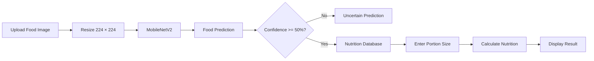

<div align="center">

# 🍽️ Food Recognition & Nutrition Estimation

### Deep Learning Food Classification using MobileNetV2

Recognize **20 food classes** from an image and estimate nutrition based on the user's portion size.

<br>


</div>

---

## ✨ Project Overview

This project uses **deep learning** to recognize food from an uploaded image.

### Input
🖼️ Food Image

### Output
- Predicted food
- Confidence score
- Food category
- Estimated calories
- Protein
- Carbohydrates
- Fat

> If confidence is below **50%**, the system returns **Uncertain Prediction** and does not display nutrition information.

---

## 🏆 Final Result

<div align="center">

| Final Model | Test Accuracy | Correct Predictions |
|---|---:|---:|
| **Improved Fine-Tuned MobileNetV2** | **95.50%** | **297 / 311** |

</div>

---

## 🧠 Deep Learning Approaches

### 01 — Transfer Learning

**MobileNetV2 with Frozen Backbone**

- ImageNet pretrained weights
- Feature extractor frozen
- New classifier for 20 food classes
- Learning rate: `0.001`

**Test Accuracy: 92.28%**

---

### 02 — Partial Fine-Tuning

**MobileNetV2 with Last 3 Blocks Unfrozen**

- Started from the transfer-learning model
- Last 3 feature blocks unfrozen
- Learning rate: `0.0001`
- 3 epochs

**Test Accuracy: 95.18%**

---

### Final Improvement

More diverse training images were added for weak classes.

The same fine-tuning strategy was continued using:

- Learning rate: `0.00005`
- 3 epochs
- Same validation and test sets

**Final Test Accuracy: 95.50%**

> The final improvement is part of Approach 2 and is not treated as a separate architecture.

---

## 📊 Model Comparison

| Model | Training Strategy | Test Accuracy |
|---|---|---:|
| MobileNetV2 | Frozen backbone | 92.28% |
| MobileNetV2 | Partial fine-tuning | 95.18% |
| **Final Model** | Fine-tuning + improved training data | **95.50%** |

---

## 🗂️ Dataset

The project uses food images from public datasets and additional publicly available internet images.

### Main Sources

- Food-101
- Fruits-360
- Additional public internet food images

### Final Dataset

| Dataset Split | Images |
|---|---:|
| Training | 2,151 |
| Validation | 596 |
| Test | 311 |
| **Total** | **3,058** |

The validation and test sets were kept unchanged during model improvement.

---

## 🍕 20 Food Classes

| Category | Food Classes |
|---|---|
| 🍔 Fast Food | Pizza, Hamburger, French Fries, Hot Dog |
| 🍎 Fruit | Apple, Banana, Orange, Strawberry |
| 🥕 Vegetable | Carrot, Broccoli, Tomato, Cucumber |
| 🥜 Nuts | Almond, Peanut, Cashew, Walnut |
| 🍰 Dessert | Donut, Ice Cream, Chocolate Cake, Cupcake |

---

## 🔄 System Workflow



---

## 🖼️ Image Preprocessing

### Training Images

```text
Resize 224 × 224
      ↓
Random Horizontal Flip
      ↓
Random Rotation ±10°
      ↓
Convert to Tensor
      ↓
ImageNet Normalization
```

### Validation & Test Images

```text
Resize 224 × 224
      ↓
Convert to Tensor
      ↓
ImageNet Normalization
```

---

## 🥗 Nutrition Estimation

Nutrition values are stored per approximately **100 g** of food.

The database contains:

- Calories
- Protein
- Carbohydrates
- Fat

### Formula

```text
Estimated Nutrition
=
Nutrition per 100g × Portion Weight / 100
```

### Example

If 100 g contains **200 kcal** and the user enters **150 g**:

```text
200 × 150 / 100 = 300 kcal
```

> The system does not automatically detect exact food weight from an image.  
> The user enters the estimated portion size.

---

## 💻 Browser Demo

The project includes a **Gradio interface**.

The user can:

1. Upload a food image
2. Enter portion size
3. Click **Analyze Food**
4. View prediction and nutrition results

Example output:

```text
Predicted Food: Pizza
Confidence: 96.52%
Category: Fast Food

Calories: 266 kcal
Protein: 11 g
Carbohydrates: 33 g
Fat: 10 g
```

---

## 📈 Evaluation

The project evaluates the model using:

- Accuracy
- Precision
- Recall
- F1-score
- Confusion Matrix
- Training Loss
- Validation Loss
- Training Accuracy
- Validation Accuracy

Results and graphs are stored inside:

```text
results/
```

---

## 🔍 Why Fine-Tuning Worked Better

The pretrained MobileNetV2 already learned useful visual features from ImageNet.

Fine-tuning allowed its final layers to adapt to food-specific features such as:

- Texture
- Shape
- Color
- Toppings
- Food presentation

Adding more diverse images also helped improve weaker classes.

---

## ⚠️ Error Analysis

Some difficult predictions happen because of:

- Different lighting
- Complex backgrounds
- Different camera angles
- Similar-looking food
- Different cooking styles
- Food appearing differently from training images

A **50% confidence threshold** helps reduce unreliable results.

---

## 📁 Project Structure

```text
food-recognition-nutrition/
│
├── 📁 dataset/
│   ├── train/
│   ├── validation/
│   └── test/
│
├── 📁 notebooks/
│
├── 📁 nutrition/
│   └── food_nutrition.csv
│
├── 📁 results/
│
├── 📁 src/
│   ├── data/
│   │   └── data.py
│   │
│   ├── models/
│   │   └── model.py
│   │
│   ├── train_transfer.py
│   ├── train_finetune.py
│   ├── train_improved.py
│   ├── evaluate.py
│   └── predict.py
│
├── 📁 slides/
│
├── requirements.txt
├── .gitignore
└── README.md
```

---

## 🚀 Installation

### 1. Clone Repository

```bash
git clone https://github.com/yeansreymom25-eng/food-recognition-nutrition.git
```

### 2. Open Project

```bash
cd food-recognition-nutrition
```

### 3. Install Packages

```bash
pip install -r requirements.txt
```

---

## ▶️ How to Run

Recommended experiment order:

```text
Dataset
   ↓
Transfer Learning
   ↓
Fine-Tuning
   ↓
Evaluation
   ↓
Final Model
   ↓
Gradio Demo
```

The complete experiment is also available inside the `notebooks/` folder.

---

## 🛠️ Technologies

| Technology | Purpose |
|---|---|
| Python | Programming |
| PyTorch | Deep Learning |
| torchvision | MobileNetV2 & image processing |
| Google Colab | Model training |
| Pandas | Nutrition data |
| Matplotlib | Result visualization |
| Scikit-learn | Evaluation metrics |
| Pillow | Image processing |
| Gradio | Browser demo |
| GitHub | Project repository |

---

## ⚠️ Limitations

- Only 20 food classes are supported.
- Unknown food may be classified as a known class.
- Softmax confidence does not guarantee correctness.
- Exact food weight cannot be detected from one normal image.
- Nutrition values are estimates.
- Cooking methods and ingredients can change nutrition values.
- More real-world training images are still needed.

---

## 🔮 Future Work

- Add more food classes
- Collect more real-world images
- Compare another deep learning architecture
- Improve unknown-food detection
- Improve confidence calibration
- Add automatic portion-size estimation
- Build a mobile application

---

## 📚 References

**Food-101 Dataset**  
https://data.vision.ee.ethz.ch/cvl/datasets_extra/food-101/

**Fruits-360 Dataset**  
https://github.com/fruits-360/fruits-360-100x100

**PyTorch**  
https://pytorch.org/

**Torchvision MobileNetV2**  
https://docs.pytorch.org/vision/main/models/generated/torchvision.models.mobilenet_v2.html

---

## 🤖 AI Use Disclosure

**Tool Used:** ChatGPT

**Scope of Use**

- Project planning
- Deep learning concept explanation
- PyTorch and Google Colab debugging
- GitHub organization
- Documentation support

**Verification**

All project code was run and tested by the project author.  
The results reported in this repository come from the actual project experiments.

---

<div align="center">

### 🎯 Final Model

**Improved Fine-Tuned MobileNetV2**

### 95.50% Test Accuracy

**297 / 311 correct predictions**

<br>

Food Recognition & Nutritional Estimation  
Deep Learning Final Project

</div>
